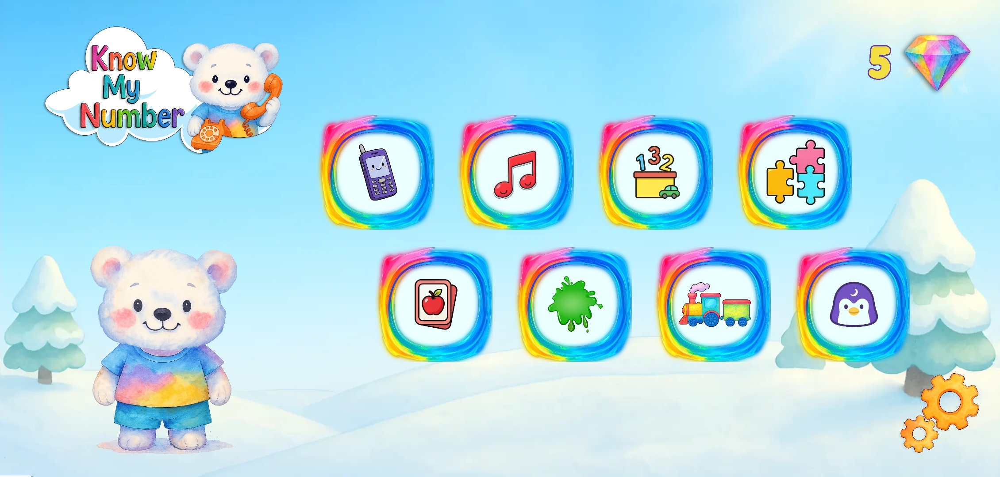
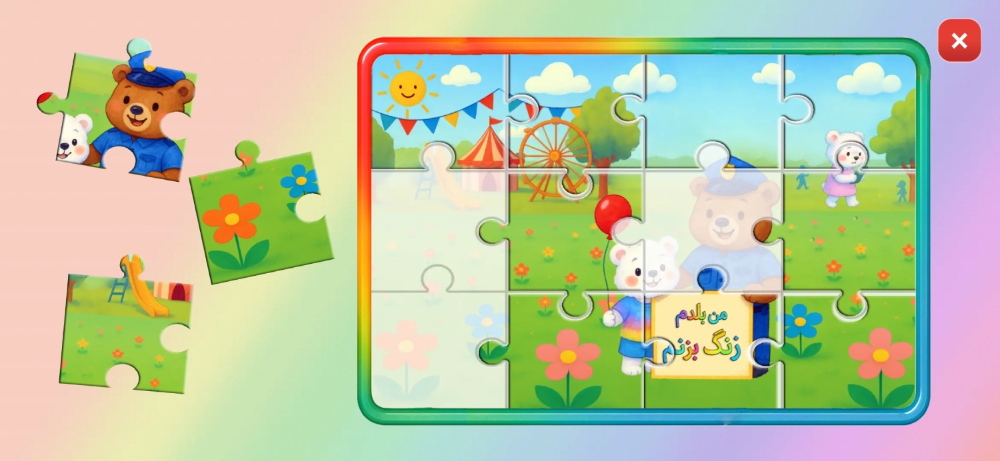

  
  
  

<h1>
  
  &nbsp; Know My Number
</h1>

**An Educational Android App for Children**

Know My Number is an educational Android application designed to help young children learn and memorize their parents' phone numbers through fun, interactive games.

The app provides a playful and child-friendly environment where children can practice remembering important phone numbers in an engaging way.

## ✨ Features

- Interactive educational games
- Fun and engaging learning activities
- Child-friendly user interface
- Phone number memorization exercises
- Reward-based gameplay

## 🛠️ Technologies & Tools

- **Language:** Kotlin
- **Platform:** Android SDK
- **UI Development:** XML Layouts
- **Backend & Analytics:** Firebase Analytics
- **Monetization:** In-App Billing & Ads Integration
- **Development Environment:** Android Studio

## 📥 Download

[Download the latest APK](https://github.com/sasemanmanzar/know-my-number-app/releases/latest)

## 🔒 Source Code

The source code is maintained in a private repository and is not publicly available.

---

## 👩‍💻 Developer

**Sara Aseman-Manzar** · Independent Android Developer
